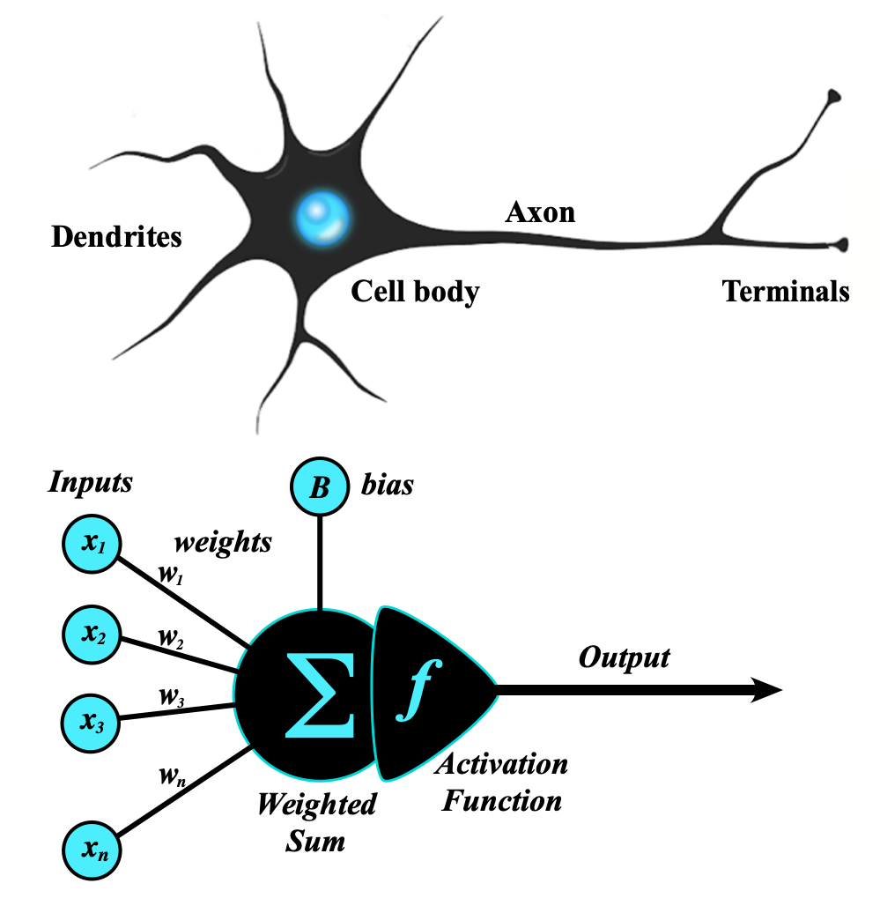
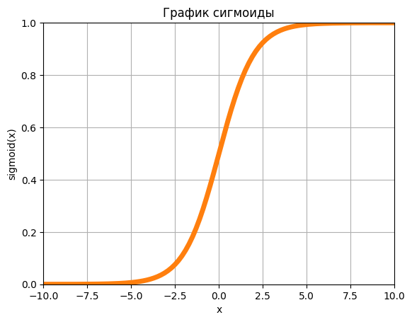
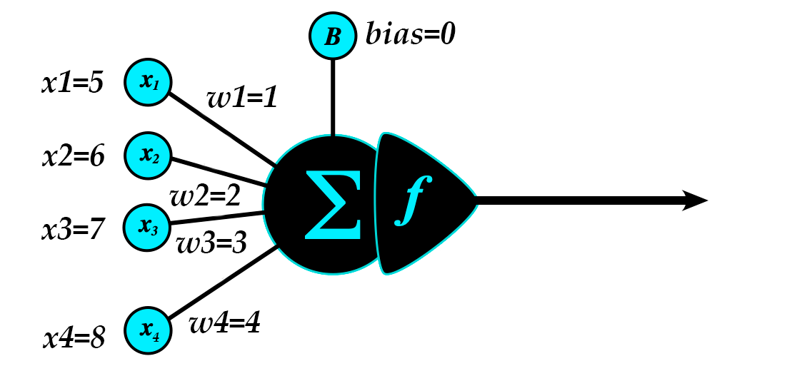
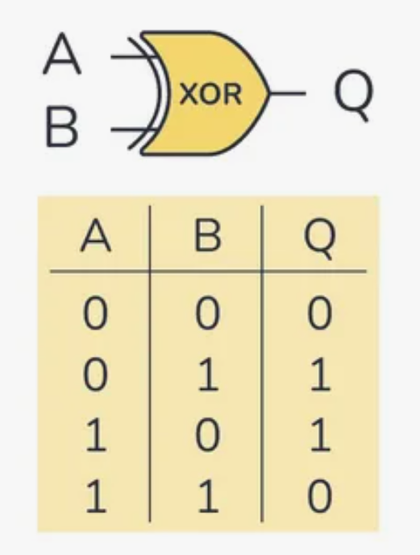
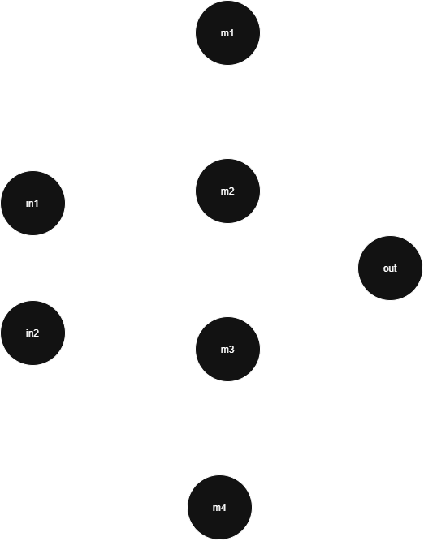

# machine-learning

Репозиторий, в котором я пытаюсь разобраться в работе нейронных сетей. Я не специалист по ML и не
особо знаток математики, но у меня есть опыт разработки на python.

### Что такое нейрон

Нейроном в ML называется модель, отдалённо напоминающая по работе реальный нейрон в живых
организмах.

Нейрон состоит из входов, весов, смещения и функции активации.

* Входы (`inputs`) - каналы, по которым нейрон получает входные данные (на картинке x1..xn).
* Веса (`weights`) - множители, на которые умножаются значения каждого из каналов (на картинке
  w1..wn).
* Смещение (`bias`) - константа, которая добавляется к взвешенной сумме нейрона (на картинке B).
* Функция активации (`activation function`) - функция, которая применяется к взвешенной сумме
  нейрона.



Для простоты объяснения, дальше по тексту, я буду считать, что `bias` всех нейронов равен 0.

### Функция активации

Я пока не знаю, чем надо руководствоваться при выборе функции активации, но в учебных статьях часто
используют сигмоиду.

Формула сигмоиды:



График сигмоиды:



По смыслу, сигмоида сводит значения в диапазоне `[-inf, inf]` к `[0, 1]`.

### Пример расчёта нейрона

Для простоты примем следующие исходные данные:

| Показатель | Значение |
|------------|----------|
| w1         | 1        |
| w2         | 2        |
| w3         | 3        |
| w4         | 4        |
| x1         | 5        |
| x2         | 6        |
| x3         | 7        |
| x4         | 8        |
| bias       | 0        |
| activation | сигмоида |

Это не совсем правдоподобные значения, но они будут нагляднее при расчётах.



Поскольку я не проходил никакого обучения по данной теме, я сужу по статьям в интернете. Судя по
ним, необходимо сначала вычислить скалярное произведение вектора входов на вектор весов.

То есть:

```
[w1, w2, w3, w4] * [x1, x2, x3, x4] => w1 * x1 + w2 * x2 + w3 * x3 + w4 * x4 
```

Или с фактическими значениями:

```
1 * 5 + 2 * 6 + 3 * 7 + 4 * 8 = 5 + 12 + 21 + 32 = 70
```

Затем прибавляем смещение (которое у нас в любом случае равно нулю):

```
70 + 0 = 70
```

И применяем к результату сигмоиду (в данном случае функция уходит в насыщение):

```
1 / (1 + e**-70) = 1.0
```

Вот мы получили выход одного нейрона. Напоминаю, что веса взяты для наглядности, на практике это
обычно маленькие числа в диапазоне `(-1, 1)`.

## Простейшая нейронная сеть с нуля на python

Для примера попробуем смоделировать функцию `XOR`.

Таблица истинности для этой функции выглядит следующим образом:



Если описывать словами, это функция, которая принимает на вход два аргумента и возвращает 1 если они
отличаются и 0 в остальных случаях.

Я не знаю как выбирается количество нейронов и количество слоёв этих нейронов. На входе у нас два
аргумента, на выходе один. Возьму один скрытый слой из 4 нейронов.

В итоге у нас получается следующая нейронная сеть:



## Фактические данные

В качестве входных данных мы будем использовать все возможные варианты входных аргументов `XOR`
т.е. `[[0, 0], [0, 1], [1, 0], [1, 1]]`. В качестве эталонных значений, по которым мы будем
проверять результат у нас будет `[[0], [1], [1], [0]]`. В качестве весов входов мы возьмём
произвольные, но наглядные значения (см. таблицу).

| Нейрон | Веса    |
|--------|---------|
| m1     | w1=0.1  |
|        | w2=0.2  |
| m2     | w1=0.3  |
|        | w2=0.4  |
| m3     | w1=0.5  |
|        | w2=0.6  |
| m4     | w1=0.7  |
|        | w2=0.8  |
| out    | w1=0.91 |
|        | w2=0.92 |
|        | w3=0.93 |
|        | w4=0.94 |

## Пример ручного расчёта нейрона m1 (такой проход называется прямое распространение - feed forward)

Для `[0, 0]`:

```
sigmoid((0 * 0.1 + 0 * 0.2) + 0) = 0.5
```

Для `[0, 1]`:

```
sigmoid((0 * 0.1 + 1 * 0.2) + 0) = 0.549833997312478
```

Для `[1, 0]`:

```
sigmoid((1 * 0.1 + 0 * 0.2) + 0) = 0.52497918747894
```

Для `[1, 1]`:

```
sigmoid((1 * 0.1 + 1 * 0.2) + 0) = 0.574442516811659
```

Чтобы не заморачиваться ручным вычислением, можем написать следующий код:

```python
import math
from typing import Sequence


def sigmoid(x):
    return 1 / (1 + math.exp(-x))


class Neuron:
    def __init__(self, weights: Sequence[float], bias: float = 0.0) -> None:
        self.weights = weights
        self.bias = bias

    def feedforward(self, inputs: Sequence[float]) -> float:
        total = sum(x * y for x, y in zip(self.weights, inputs)) + self.bias
        return sigmoid(total)


m1 = Neuron([0.1, 0.2])
m2 = Neuron([0.3, 0.4])
m3 = Neuron([0.5, 0.6])
m4 = Neuron([0.7, 0.8])
out = Neuron([0.91, 0.92, 0.93, 0.94])

# для [0, 0]
print(m1.feedforward([0, 0]))  # 0.5
print(m2.feedforward([0, 0]))  # 0.5
print(m3.feedforward([0, 0]))  # 0.5
print(m4.feedforward([0, 0]))  # 0.5
print(out.feedforward([0.5, 0.5, 0.5, 0.5]))  # 0.8641271029909058

# для [0, 1]
print(m1.feedforward([0, 1]))  # 0.549833997312478
print(m2.feedforward([0, 1]))  # 0.598687660112452
print(m3.feedforward([0, 1]))  # 0.6456563062257954
print(m4.feedforward([0, 1]))  # 0.6899744811276125
print(out.feedforward([0.549833997312478,
                       0.598687660112452,
                       0.6456563062257954,
                       0.6899744811276125]))  # 0.9088917766408675

# для [1, 0]
print(m1.feedforward([1, 0]))  # 0.52497918747894
print(m2.feedforward([1, 0]))  # 0.574442516811659
print(m3.feedforward([1, 0]))  # 0.6224593312018546
print(m4.feedforward([1, 0]))  # 0.668187772168166
print(out.feedforward([0.52497918747894,
                       0.574442516811659,
                       0.6224593312018546,
                       0.668187772168166]))  # 0.9014287937424282

# для [1, 1]
print(m1.feedforward([1, 1]))  # 0.574442516811659
print(m2.feedforward([1, 1]))  # 0.668187772168166
print(m3.feedforward([1, 1]))  # 0.7502601055951177
print(m4.feedforward([1, 1]))  # 0.8175744761936437
print(out.feedforward([0.574442516811659,
                       0.668187772168162,
                       0.7502601055951177,
                       0.8175744761936437]))  # 0.9311017219464212
```

Поздравляю, мы только что написали работающий прототип нейронной сети. Одна проблема - она выдаёт
мусор так как веса сети взяты с потолка. Чтобы эта сеть была хоть как-то полезна, нам необходимо
оценить ошибку расчёта и произвести корректировку весов.

## Обратное распространение ошибки (Backpropagation)

На этом этапе мы вычисляем насколько нейронная сеть ошиблась. Двигаясь от конца к началу мы
определяем, какие веса больше всего повлияли на величину ошибки и корректируем их.

Способ вычисления ошибки - `1/2 * (результат - эталон)**2`. Насколько я понимаю, выбор этой функции
это отдельная большая история в мире ML.

Тут нам понадобится производная нашей функции активации. Производная показывает, насколько быстро
меняется значение функции в каждой точке, так что мы сможем определить вклад различных частей сети в
результат.

Производная сигмоиды это `f'(z) = a * (1 − a), где a = f(z)`.

Или:

```python
import math


def sigmoid(x):
    return 1 / (1 + math.exp(-x))


def sigmoid_derivative(z):
    a = sigmoid(z)
    return a * (1 - a)
```

| Вход (x) | Эталон (y) | Получили (a) | Отклонение (a-y) | Производная a*(1-a) | Дельта (производная * отклонение) |
|----------|------------|--------------|------------------|---------------------|-----------------------------------|
| `[0, 0]` | 0          | 0.8641271    | +0.8641271       | 0.11741145504558997 | +0.1014584                        |
| `[0, 1]` | 1          | 0.9088918    | −0.0911082       | 0.08280757767111002 | -0.0075444                        |
| `[1, 0]` | 1          | 0.9014288    | −0.0985712       | 0.08885491853055998 | -0.0087585                        |
| `[1, 1]` | 0          | 0.9311017    | +0.9311017       | 0.06415132425710997 | +0.0597314                        |

Когда мы делали прямой проход, мы вычисляли множители нейронов.

| Вход (x) | Множители (h_j)                                |
|----------|------------------------------------------------|
| `[0, 0]` | `[0.5000000, 0.5000000, 0.5000000, 0.5000000]` |
| `[0, 1]` | `[0.5498340, 0.5986877, 0.6456563, 0.6899745]` |
| `[1, 0]` | `[0.5249792, 0.5744425, 0.6224593, 0.6681878]` |
| `[1, 1]` | `[0.5744425, 0.6681878, 0.7502601, 0.8175745]` |

Сейчас эти множители нам понадобятся. У нас 4 дельты, для каждой из которых надо выполнить обратный
проход. Каждая из дельт будет применяться к каждому из имеющихся у нас скрытых нейронов. Тут нам
ещё понадобится гиперпараметр, отвечающий за скорость обучения (learning rate). Примем его равным
0.1. Тогда мы можем скорректировать веса выходного нейрона.

Для дельты 1 и варианта `[0, 0]`:

| Исх. вес | Поправка (δ) | h_j | Градиент (δ * h_j) | Формула                | Новый вес  |
|----------|--------------|-----|--------------------|------------------------|------------|
| 0.91     | +0.1014584   | 0.5 | 0.0507292          | 0.91 - 0.1 * 0.0507292 | 0.90492708 |
| 0.92     | +0.1014584   | 0.5 | 0.0507292          | 0.92 - 0.1 * 0.0507292 | 0.91492708 |
| 0.93     | +0.1014584   | 0.5 | 0.0507292          | 0.93 - 0.1 * 0.0507292 | 0.92492708 |
| 0.94     | +0.1014584   | 0.5 | 0.0507292          | 0.94 - 0.1 * 0.0507292 | 0.93492708 |

Для дельты 2 и варианта `[0, 1]` (шаг от исходных весов):

| Исх. вес | Поправка (δ) | h_j       | Градиент (δ * h_j) | Формула                | Новый вес  |
|----------|--------------|-----------|--------------------|------------------------|------------|
| 0.91     | -0.0075444   | 0.5498340 | -0.0041482         | 0.91 + 0.1 * 0.0041482 | 0.91041482 |
| 0.92     | -0.0075444   | 0.5986877 | -0.0045167         | 0.92 + 0.1 * 0.0045167 | 0.92045167 |
| 0.93     | -0.0075444   | 0.6456563 | -0.0048711         | 0.93 + 0.1 * 0.0048711 | 0.93048711 |
| 0.94     | -0.0075444   | 0.6899745 | -0.0052054         | 0.94 + 0.1 * 0.0052054 | 0.94052055 |

Для дельты 3 и варианта `[1, 0]` (шаг от исходных весов):

| Исх. вес | Поправка (δ) | h_j       | Градиент (δ * h_j)  | Формула                | Новый вес  |
|----------|--------------|-----------|---------------------|------------------------|------------|
| 0.91     | -0.0087585   | 0.5249792 | -0.0045980          | 0.91 + 0.1 * 0.0045980 | 0.91045980 |
| 0.92     | -0.0087585   | 0.5744425 | -0.0050313          | 0.92 + 0.1 * 0.0050313 | 0.92050313 |
| 0.93     | -0.0087585   | 0.6224593 | -0.0054518          | 0.93 + 0.1 * 0.0054518 | 0.93054518 |
| 0.94     | -0.0087585   | 0.6681878 | -0.0058523          | 0.94 + 0.1 * 0.0058523 | 0.94058523 |

Для дельты 4 и варианта `[1, 1]` (шаг от исходных весов):

| Исх. вес | Поправка (δ) | h_j       | Градиент (δ * h_j) | Формула                | Новый вес  |
|----------|--------------|-----------|--------------------|------------------------|------------|
| 0.91     | 0.0597314    | 0.5744425 | 0.0343123          | 0.91 - 0.1 * 0.0343123 | 0.90656877 |
| 0.92     | 0.0597314    | 0.6681878 | 0.0399118          | 0.92 - 0.1 * 0.0399118 | 0.91600882 |
| 0.93     | 0.0597314    | 0.7502601 | 0.0448141          | 0.93 - 0.1 * 0.0448141 | 0.92551859 |
| 0.94     | 0.0597314    | 0.8175745 | 0.0488349          | 0.94 - 0.1 * 0.0488349 | 0.93511651 |

В реальности применение изменений идёт последовательно, поэтому вместо 4 снимков от исходных весов
фактически получается последовательное их изменение.

На практике будет вот так:

| №   | x       | 	y  | Веса out перед шагом                    | a         | a − y      | a(1−a)    | δ          |
|-----|---------|-----|-----------------------------------------|-----------|------------|-----------|------------|
| 1   | `[0,0]` | 	0  | 0.91      0.92      0.93      0.94	     | 0.8641271 | +0.8641271 | 0.1174115 | +0.1014584 |
| 2   | `[0,1]` | 	1  | 0.9049271 0.9149271 0.9249271 0.9349271 | 0.9078429 | −0.0921571 | 0.0836642 | −0.0077103 |
| 3   | `[1,0]` | 	1  | 0.9053510 0.9153887 0.9254249 0.9354591 | 0.9004496 | −0.0995504 | 0.0896401 | −0.0089237 |
| 4   | `[1,1]` | 	0  | 0.9058195 0.9159013 0.9259804 0.9360553 | 0.9303680 | +0.9303680 | 0.0647834 | +0.0602724 |
